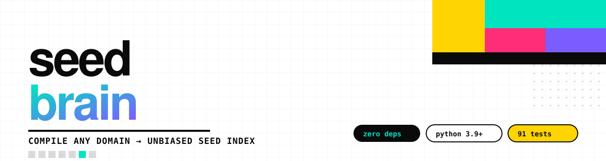

<p align="center">
  <a href="https://pypi.org/project/agent-seed-brain/"></a>
  
  
  
  
  
</p>

<p align="center">
  <b>English</b> · <a href="README.zh-CN.md">简体中文</a>
</p>

<h3 align="center">Compile any domain of knowledge into a seed index that agents can <b>retrieve without bias</b>, <b>evolve incrementally</b>, and <b>verify themselves</b>.</h3>

<p align="center">
  <kbd>zero dependencies</kbd> · <kbd>deterministic</kbd> · <kbd>explainable</kbd> · <kbd>verifiable</kbd>
</p>

---

## What it actually changes

Most agents pick an approach by reaching for the **most frequent tokens in their
pretraining corpus**. That is why "make a tech-style poster" always returns
cyberpunk neon, and "do some numerics" always returns gradient descent.

`seedbrain` does not improve reasoning. It does something else:

> **It moves "what to choose" out of the model weights and into data that can be
> searched, audited, and verified.**

| Stage | Model on its own | With a seed brain |
|---|---|---|
| **What to choose** | whatever is most frequent in the corpus | the whole library laid out flat + IDF weighting, so rare-but-precise entries still surface |
| **Stability** | different answers across sessions | deterministic scoring: same input, same output |
| **Explainability** | cannot say why | every result prints its hit signals and weights (`neon·4.3  long-image·3.3`) |
| **Accumulation** | forgotten when the session ends | increment pool + state memory; it gets sharper with use |
| **Anti-regression** | none | 28 threshold assertions in CI; algorithmic regressions turn red |

## Why the gain is independent of harness and model size

```
"did we choose well"    ← index quality + matching algorithm  ← model-independent
"what to do afterwards" ← model reasoning                     ← model-dependent
```

`seedbrain` only owns the first half. So on **any harness (Claude Code / Codex /
pi / your own loop) and any model (strong or weak)** the effect is the same: a
weak model stops guessing and starts receiving the same candidate set; a strong
model goes from "reasonable pick" to "explainable, reproducible pick".

---

## Install

**① From PyPI**

```bash
pip install agent-seed-brain
seedbrain --version
```

Isolated CLI instead of a library:

```bash
pipx install agent-seed-brain
```

**② From source** — needed if you want the bundled example domain, because
`profiles/` and `tests/fixtures/` live in the repository, not in the wheel:

```bash
git clone https://github.com/hhx465453939/agent-seed-brain
cd agent-seed-brain
pip install -e .
seedbrain --version
```

**③ Zero install**

```bash
git clone https://github.com/hhx465453939/agent-seed-brain
cd agent-seed-brain
PYTHONPATH=src python examples/minimal.py
```

> **Note on what ships in the wheel:** the engine, `seedbrain/data/base.json`,
> and `seedbrain/data/probes/core.json`. So `builtin:base` and
> `builtin:probes/core` work after a plain `pip install`; the example profile
> does not. Full detail: [docs/en/getting-started.md §3](docs/en/getting-started.md#3-what-is-actually-inside-the-installed-package).

### Release pipeline

Publishing runs in `.github/workflows/release.yml` (Trusted Publishing / OIDC, no
API token). The whole chain is idempotent: verify → build → publish to PyPI
(existing files are skipped) → create a GitHub Release (existing ones are
synced).

- **Normal release:** bump `version` in `pyproject.toml`, tag `v0.4.0`, push.
  The pipeline asserts the tag matches the package version and refuses otherwise.
- **Backfill an old version:** dispatch the workflow with `tag` set (e.g.
  `v0.1.1`). Existing files and releases are skipped or updated — never an error.

---

## Quick start (the pip path)

The five-minute version. It is the one that works after `pip install`, and it is
verified end to end.

```bash
mkdir my-brain && cd my-brain && mkdir notes
```

Write `notes/methods.md` — any format you like, as long as the profile knows how
to parse it:

```markdown
# Numerical Methods

## Matrix & decomposition

- **Matrix decomposition** · svd —— 奇异值分解，把矩阵拆成低秩结构，降维与压缩的通用手段
- **Low-rank approximation** · truncated-svd —— 截断奇异值，只保留最大的若干个，用于压缩与去噪
- **QR iteration** · qr —— QR 迭代求特征值，适合中小规模稠密矩阵
- **PCA projection** · pca —— 主成分投影，用方差最大的方向做线性降维
- **Randomized sketch** · sketch —— 随机投影草图，用低维嵌入近似原矩阵，降维压缩的近似加速

## Optimization

- **Gradient descent** · gd —— 沿负梯度方向迭代，最基础的一阶优化
- **Newton step** · newton —— 用二阶信息校正步长，收敛快但需要 Hessian
- **Conjugate gradient** · cg —— 共轭方向法，解大型稀疏线性系统
- **Backtracking line search** · backtracking —— 回溯线搜索，保证每步充分下降

## Statistics

- **Bootstrap CI** · resample —— 重采样估计置信区间，不依赖分布假设
- **Jackknife** · leave-one-out —— 留一法估计偏差与方差
- **Permutation test** · shuffle-test —— 置换检验，用打乱标签构造零分布
```

Write `seedbrain.json`:

```json
{
  "extends": "builtin:base",
  "name": "numerics",
  "label": "Numerical Methods",
  "sources": [
    {
      "kind": "table",
      "path": "notes/methods.md",
      "layer": "method",
      "group_re": "^##\\s+(?P<group>[^#].*)$",
      "entry_re": "^-\\s*\\*\\*(?P<name>[^*]+?)\\*\\*\\s*·\\s*(?P<tag>[^—]+?)\\s*——\\s*(?P<desc>.+)$"
    }
  ],
  "layers": {
    "method": { "prefix": "m", "quota": 1.0, "label": "Methods" }
  },
  "verify": {
    "probes_ref": "builtin:probes/core",
    "probes": ["降维压缩，矩阵分解选型"]
  }
}
```

Build and query:

```bash
seedbrain build --profile seedbrain.json
seedbrain match "降维压缩，矩阵分解选型" --profile seedbrain.json --k 5
```

```
 #  层              得分    新颖  id                         命中信号
─────────────────────────────────────────────────────────────────────────
 1  method        4.9  1.00  m-randomized-sketch        压缩·1.4  矩阵·1.4  降维压·0.7
 2  method        4.4  1.00  m-matrix-decomposition     分解·1.9  压缩·1.4  降维·1.4  矩阵·1.4
```

Prove it:

```bash
seedbrain verify --profile seedbrain.json     # 27/27 on this example
```

(`27`, not `28`: `T9` requires a `verify.legacy_shelf`, and it is skipped rather
than faked when absent. Very small corpora fail `T5` by design — four distinct
top-1 picks across six runs needs more than three entries.)

→ Full walkthrough, troubleshooting, uninstall:
[docs/en/getting-started.md](docs/en/getting-started.md)

---

## Use it from an agent

`seedbrain` is a **library + CLI** and binds to no harness. Two integrations:

**A. As a CLI in the agent's rule file**

Add: "before choosing an approach, run `seedbrain match`".

```bash
seedbrain match "tech-style long image, dark background, neon" \
  --profile profiles/taste.json \
  --root ~/agent-taste-seed-system \
  --k 8
```

**B. As a library inside your own loop**

```python
from seedbrain import SeedBrain

brain = SeedBrain.load("seedbrain.json")
if not brain.seeds:
    brain.build()

for m in brain.match("降维压缩，矩阵分解选型", k=5):
    print(f"{m.total:6.1f}  {m.seed.id:<28} {m.hits[:2]}")

brain.pick("m-matrix-decomposition", score=5, note="one shot")
```

`--root` points at **the repository where the content lives**. The SDK repository
holds only parsing rules, never seed content — that separation is the
precondition for license isolation.

---

## Add your own domain

One domain = one JSON file. **No Python.**

```jsonc
{
  "extends": "builtin:base",          // shared norms, paths, thresholds
  "name": "my-domain",
  "sources": [
    {
      "kind": "table",                // many entries in one file
      "path": "docs/methods.md",
      "layer": "method",
      "group_re": "^##\\s+(?P<group>.*)$",
      "entry_re": "^-\\s*\\*\\*(?P<name>[^*]+?)\\*\\*\\s*·\\s*(?P<tag>[^—]+?)\\s*——\\s*(?P<desc>.+)$"
    },
    {
      "kind": "card",                 // one file per entry
      "dir": "docs/cards",
      "layer": "card",
      "title_re": "^#\\s+(?P<title>.+)$",
      "field_re": "^>\\s*\\*\\*(?P<key>[^*]+?)\\*\\*\\s*[：:]\\s*(?P<val>.*)$"
    }
  ],
  "layers": {
    "method": { "prefix": "m",  "quota": 0.6 },
    "card":   { "prefix": "cd", "quota": 0.4 }
  }
}
```

Merge rules are exactly two: **dicts merge recursively, lists and scalars are
replaced**. That is why probes have their own field:

```jsonc
{
  "verify": {
    "probes_ref": "builtin:probes/core",        // pool first
    "probes": ["domain-specific one", "two"]    // local second
  }
}
```

`builtin:` resolves inside the installed package, so a domain repository can
reference shared config with **zero copies, zero drift**, tracking the SDK
version.

Not sure where a value came from?

```bash
seedbrain config --profile my-domain.json --chain   # inheritance chain
seedbrain config --profile my-domain.json           # final merged config
```

→ Full field reference: [docs/en/profiles.md](docs/en/profiles.md)

---

## Three real failure modes it fixes

<table>
<tr><td width="33%" valign="top">

**① The shortlist has twelve rows**

A hand-written "quick index" structurally leaves most of the library **with no
entry point at all**. Not author bias — the door is too narrow.

</td><td width="33%" valign="top">

**② The same task keeps hitting the same entry**

No state memory, so the model circles inside the same high-frequency set.

</td><td width="34%" valign="top">

**③ The library changed, the index did not**

Retrieval keeps serving a stale snapshot, new entries are unreachable, **and
nothing reports an error**.

</td></tr>
</table>

## Four mechanisms (none of them random)

| Mechanism | Fixes | Math |
|---|---|---|
| **IDF weighting** | rare-but-precise signals drowned by common words | `log(1 + N/(1+df))` |
| **Cross-layer quota** | large layers squeezing small ones out of `top-K` | two phases: guarantee per layer, then fill globally |
| **Time decay** | the same task re-hitting the same entry | `recovery × count penalty`, 14-day half-life, floor 0.15 |
| **Increment equivalence** | new entries shuffling old IDs and references | append-only suffixes; split-half bitwise equivalence |

**Deliberately no randomness**: suitability is decided by IDF (deterministic,
explainable, reproducible); diversity comes from state memory — the same task a
few days later returns different *equally suitable* candidates, not random
*unsuitable* ones.

→ Derivations, trade-offs, and known limits: [docs/en/methodology.md](docs/en/methodology.md)

---

## Verification: it proves itself

```bash
seedbrain verify --profile profiles/example.json
seedbrain verify --profile profiles/example.json --evidence reports/verify.md
```

```
[PASS] T1a ID uniqueness              duplicates 0
[PASS] T2a name self-recall@8         100.0%
[PASS] T3a hit Gini                   0.154
[PASS] T4a IDF monotonicity           df=1 "hypothesis" 2.48 vs df=19 "signal" 0.74
[PASS] T5  top-1 diversity over 6     4 distinct
[PASS] T6a layer starvation           0
[PASS] T9  top-1 outside old shelf    50.0%
[PASS] T10 increment equivalence      22/22 bitwise
...
result: 28/28 passed
```

**107 unit/integration tests**, standard-library `unittest` only — nothing to
install:

```bash
PYTHONPATH=src python -m unittest discover -s tests
```

> The assertions can actually fail. During development they caught two real bugs
> in this project itself: a quota with an upper bound but no lower bound, and a
> novelty floor that dropped to 0.11 after the count penalty.

→ Assertion groups, exit codes, CI recipes: [docs/en/usage.md](docs/en/usage.md)

---

## Production instance: the aesthetic brain

<a href="https://github.com/hhx465453939/agent-taste-seed-system"></a>

[`agent-taste-seed-system`](https://github.com/hhx465453939/agent-taste-seed-system)
uses this engine to manage a style library of **24 chapters and 250+ artists**
(352 chapter entries + 12 code-genre cards + 10 mood profiles).

The problem it solved: different visual tasks kept converging on the same handful
of cyberpunk-neon / Swiss-typography entries.

| Metric | Value |
|---|---|
| top-1 outside the old shortlist | **62.5%** (15/24 tasks) |
| distinct top-1 picks | 21/24 |
| top-1 hit rate, IDF on vs off | **100% vs 11.5%** |
| distinct top-1 across 6 consecutive runs of one task | 6 |

> SDK and content are strictly separated: this repository ships the engine and
> parsing rules, **not a single seed**. The aesthetic corpus lives in its own
> repository and carries that repository's license; this repository is
> Apache-2.0. They are separate copyright objects.

---

## Documentation

| Topic | English | 简体中文 |
|---|---|---|
| Install, first index, troubleshooting | [getting-started](docs/en/getting-started.md) | [快速上手](docs/zh-CN/getting-started.md) |
| CLI + library API reference | [usage](docs/en/usage.md) | [使用参考](docs/zh-CN/usage.md) |
| Profile schema, `extends`, `probes_ref` | [profiles](docs/en/profiles.md) | [Profile 参考](docs/zh-CN/profiles.md) |
| Algorithm, trade-offs, known limits | [methodology](docs/en/methodology.md) | [方法论](docs/zh-CN/methodology.md) |
| FAQ and troubleshooting | [faq](docs/en/faq.md) | [常见问题](docs/zh-CN/faq.md) |

Contributing: [CONTRIBUTING.md](CONTRIBUTING.md) · Changelog: [CHANGELOG.md](CHANGELOG.md)
· Security: [SECURITY.md](SECURITY.md) · Conduct: [CODE_OF_CONDUCT.md](CODE_OF_CONDUCT.md)

---

## License

**Apache License 2.0** — the whole repository, with no per-asset carve-outs.

| Asset | License |
|---|---|
| Code (`src/`, `examples/`) | **Apache-2.0** |
| `profiles/*.json` | Apache-2.0 (**parsing rules only, no seed content**) |
| `tests/fixtures/` | Apache-2.0 (hand-written neutral examples) |
| The name "seed brain / 种子大脑" and the banner | **all rights reserved** (trademark and visual identity — not covered) |
| Upstream aesthetic corpus | **not in this repository** — licensed by its own repository |

Full terms in [LICENSE](LICENSE); attribution and reserved marks in [NOTICE](NOTICE).

### Version history: relicensed at v0.5.0

Versions up to and including **v0.3.x** were published under **CC BY-NC-SA 4.0**
(non-commercial, share-alike). Those releases stay under their original license —
a license already granted cannot be revoked. **From v0.5.0 the whole repository
is Apache-2.0**, an OSI-approved open source license: commercial use,
modification, and redistribution are permitted under its terms, with the usual
attribution and NOTICE requirements.

There was never a v0.4.0 release; v0.5.0 jumps ahead of the optional vector
backend still tracked in the roadmap.

---

## Roadmap

- [x] v0.1.0 — flat layout / IDF matching / cross-layer quota / state decay / increment pool / 28 assertions / CLI + library API
- [x] v0.2.0 — profile inheritance (`extends`) and `seedbrain config`
- [x] v0.3.0 — composable probes (`probes_ref`) and `builtin:` package-relative references
- [ ] v0.4.0 — optional vector backend (keeping the zero-dependency default path unchanged)
- [ ] v1.0.0 — API freeze + migration guide

---

<p align="center">
  <sub>Built with <a href="https://github.com/hhx465453939/agent-taste-seed-system">aesthetic-brain</a> ·
  Apache-2.0 · open source · zero runtime dependencies</sub>
</p>
